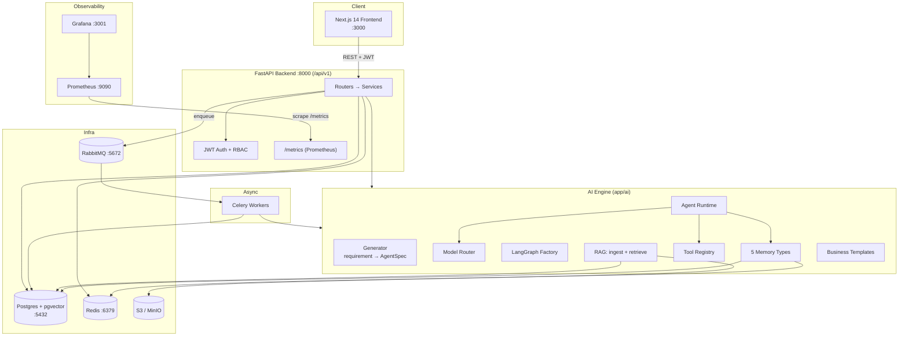
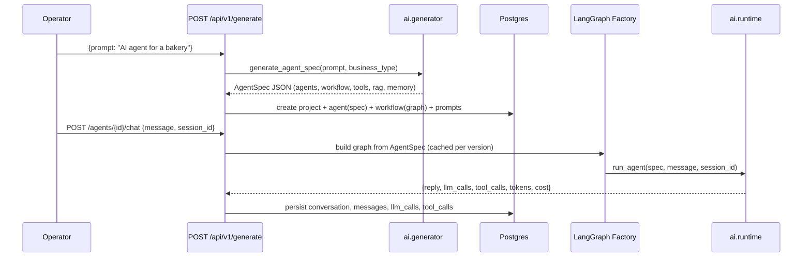

# AgentForge — Architecture

AgentForge is an Agent-as-a-Service platform: agency operators create business projects, capture customer requirements in plain English, and the platform generates, customizes, and deploys LangGraph-powered AI agents for any SMB.

## System diagram

## Component responsibilities

| Component | Responsibility |
|---|---|
| **Frontend** (Next.js 14 App Router) | Dashboard, visual workflow builder (React Flow), chat playground, prompt versioning UI, knowledge upload, template marketplace, logs, settings |
| **Backend** (FastAPI) | Thin routers → services; auth (JWT), multi-tenant CRUD, analytics, audit; imports the AI engine only through its public interface |
| **AI Engine** (`app/ai`) | Generator, model router, LangGraph agent factory, runtime, RAG, memory, tools, multi-agent supervision, prompt templating, business templates |
| **Celery workers** | Document ingestion, simulations/evals, deploy artifact generation, long-running agent tasks (broker: RabbitMQ, results: Redis) |
| **Postgres + pgvector** | System of record for all tenant data + embedded vectors for RAG |
| **Redis** | Cache, session/short-term memory, Celery result backend |
| **Prometheus + Grafana** | Request rate, latency, LLM token usage and cost dashboards |

## Core data flow: requirement → running agent

1. **Requirement** — operator enters a natural-language requirement (or picks a business template).
2. **Generator** — `generate_agent_spec` uses the model router to pick an LLM and emits a validated **AgentSpec** (versioned JSON: agents, supervisor, workflow graph with node positions, tools, RAG, memory, integrations, deployment).
3. **Persistence** — backend creates project, agent (`spec` JSONB), workflow (`graph` JSONB), and prompts; the frontend renders `workflow.nodes/edges` directly in React Flow.
4. **LangGraph factory** — compiles the AgentSpec into a runnable graph: agent nodes, tool nodes, condition edges, optional supervisor routing across the agent team.
5. **Runtime** — `run_agent` executes the graph per message/session, wiring memory (session, customer, short/long-term, vector) and tools, and returns reply + full telemetry (tokens, cost, latency) that the backend persists to `llm_calls`/`tool_calls`.
6. **Deployment** — `POST /deployments` produces artifacts per mode (docker / cloud / vps / local) and tracks status/url.

All AI functions degrade gracefully: with no API keys configured they return deterministic responses marked `"stub": true`, so the entire platform works end-to-end without credentials.

## Multi-tenancy model

- Every domain table carries `tenant_id` (FK → `tenants.id`); all queries are tenant-scoped in the service layer.
- Registration (`POST /auth/register`) creates a tenant plus its `owner` user atomically.
- JWT claims: `sub` (user id), `tenant_id`, `role`. `get_current_user` resolves the tenant; `require_role(...)` enforces RBAC (`owner` > `admin` > `member` > `viewer`).
- API keys (`api_keys` table, hashed, scoped) allow machine access bound to a tenant.
- Vector data is isolated per knowledge base, which is itself tenant-scoped via its project.

## Plugin extension points

The platform is extended through registries, not forks (details + code in [EXTENDING.md](EXTENDING.md)):

1. **Tool registry** (`app/ai/tools/`) — register builtin/api/webhook/mcp tools by name; AgentSpecs reference tools by name only, so new integrations (Gmail, GCal, WhatsApp, Stripe, ...) drop in without runtime changes.
2. **Provider registry / model router** (`app/ai/router/`) — add LLM providers (OpenAI, Anthropic, Google, DeepSeek, Ollama) with cost/context metadata; `select_model(task, constraints)` picks per AgentSpec `model_policy` (cost / latency / accuracy priority).
3. **Vector-store adapters** (`app/ai/rag/`) — pgvector ships by default; adapters conform to a common ingest/retrieve interface so Qdrant/Chroma/etc. can be swapped per knowledge base (`vector_store` column).
4. **Business templates** (`app/ai/templates/`) — AgentSpec JSONs per business type (bakery, barber, gym, dentist, ... ≥12); `POST /templates/{id}/instantiate` clones one into a client project.

## Repository layout

See `CONTRACT.md` at the repo root for the authoritative monorepo layout, service ports, and env var contract.
